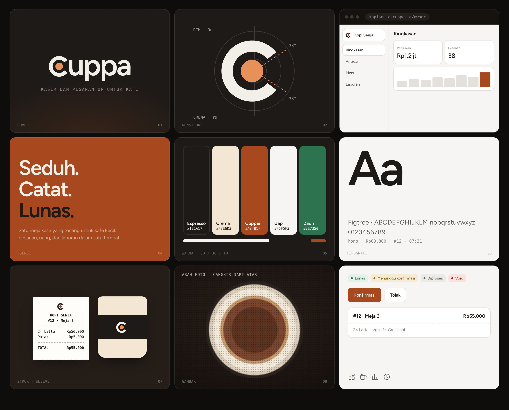

# Cuppa — Design System

Source of truth for every screen. Tokens live in `static/css/tokens.css`; never hardcode a value that has a token.
Fonts, icons and every asset are self-hosted (strict CSP, works offline).

## Brand

**Name.** *Cuppa* is the everyday word for a cup. The brand lives in that cup.

**Logo.** The initial **C** *is* a coffee cup seen from above: the thick ring is the rim, the open side is where the handle sits, and the disc inside is the crema. One mark, two readings (a letter and an object), built from two circles and a 38° opening (`static/brand/mark.svg`, construction on board panel 02). In the wordmark the mark replaces the first letter, so the word reads *Cuppa* and the cup is already in it.

**Palette.** Espresso `#1E1A17` (ink), Crema `#F3E6D3`, Copper `#A8481F` (the single accent), Uap `#F6F5F3` (paper), Daun `#2E7350` (meaning: paid/ok). Proportion 60 / 30 / 10.

**Voice.** Short, calm, concrete. Tagline: *Seduh. Catat. Lunas.* (brew, record, paid).

**Image direction.** Cups from above, halftone, warm dark. No stock people, no neon.

**Assets.** `static/brand/mark*.svg`, `static/brand/board.html` (the board, regenerate the PNG by opening it at 1560 px wide), PWA icons in `static/icons/` rendered from the same geometry.

## App shell (reference-driven)

A quiet sidebar on the page colour with an account switcher on top, one rounded white frame for content, a breadcrumb bar with the shift state, stat cards with a delta arrow, bar charts with mono axes, mono table headers, soft-tint status chips and initial tiles. Radii: controls 10, cards 14, frame 16. Shadows are layered hairlines. Motion follows the Emil/better-ui rules: press scale 0.96 at 150 ms ease-out, `cubic-bezier(.23,1,.32,1)`, only `transform`/`opacity`/colour, hover effects only on hover-capable pointers, everything gated by `prefers-reduced-motion`.

Static assets carry `?v=<boot time>` so a new release is never served from a stale cache or the service worker.

## Food-app layer

Menu is shown like an ordering app, not a table: photo cards with description, price and a round add button; tapping opens a detail sheet (photo, description, options). Customer: search, sticky category chips, dark floating cart bar. Cashier: photo grid on the left, order detail panel on the right. Owner: photo cards with stock badge and icon actions (edit, variants, recipe, hourly price, sold out, active), each with a tooltip and an aria-label; one form for photo, description, price, cost (live margin) and stock. Icons live in `static/css/menu.css` as masks from one 24px stroke set. Items without a photo get a tinted initial tile.

## Direction

- **Product.** Cuppa is a self-hosted POS and QR ordering app for small Indonesian cafés, used by cashiers on tablets, owners on laptops and customers on phones.
- **Character.** Calm, exact, a little warm.
- **World.** The café counter: espresso, ceramic, thermal paper receipts.
- **Moments.** The thermal receipt (rendered like a real slip with a torn edge), the owner's sales chart (one neutral line, today in the accent), the queue display numbers.
- **Signature.** The perforated stub: order tickets have a dashed tear line with notches, the receipt has a torn edge. Used on tickets and receipts only.

References: design-pulse playbook (`ui-build-workflow`, `dashboard-design-checklist`, "where Claude's default UI goes wrong") and the unslop passes (spacing, color, icons, copy, type, layout, details, visuals, motion).

## What changed in the unslop pass

- Removed: 700–800 weights, uppercase tracked labels, bordered "pill" chips, loud bordered cards everywhere, the two-tone heavy sidebar.
- Chrome is quiet: one neutral ramp, hairline borders (`--line`), the accent only on the primary action, the active nav icon and today's data point.
- Sentence case everywhere, no trailing periods on short strings, icons from one set (1.6 stroke), all as CSS masks so they inherit color.
- Controls are 36px on a pointer device and 44px on touch (`pointer: fine` / coarse).

## Color

| Token | Light | Dark | Use |
| --- | --- | --- | --- |
| `--paper` | `#F6F5F3` | `#141312` | page |
| `--surface` | `#FFFFFF` | `#1C1B1A` | raised panels, inputs |
| `--surface-2` | `#EFEDEA` | `#242220` | hover, sunken |
| `--line` | `rgba(30,26,23,.10)` | `rgba(242,238,232,.10)` | hairlines |
| `--ink` / `--ink-2` / `--ink-3` | `#1E1A17` / `#5E5750` / `#8A837B` | `#F2EEE8` / `#B5AEA5` / `#857E76` | text roles |
| `--accent` | `#A8481F` | `#E8905A` | primary action, selection, today |
| `--ok` `--warn` `--danger` | `#2E7350` `#946000` `#B3261E` | tuned | meaning only, always with a text label |

Customers can pick another accent (copper, green, blue, rose) in Settings; the neutrals never change.

## Type

Figtree (variable, self-hosted, OFL) for the interface; system mono for receipts. Scale `12 / 13 / 15 / 17 / 20 / 24 / 32`, weights 400 / 500 / 600 only. Figures use tabular numerals.

## Space, shape, motion

4px grid (`4 8 12 16 24 32 48`). Radius: controls 10, cards 14, frame 16. Depth is hairlines, not shadows (only the receipt, a physical object, has one).
Motion is 120ms color/transform feedback on one easing curve. Nothing loops. `prefers-reduced-motion` is respected.

## Screens

Sign in · Setup wizard · Owner overview (stats with comparison, 14-day chart, top menu) · Reports · Menu (variants, stock, cost) · Cashier queue (tickets) · New order · Order detail (split payment, discount, voucher, refund) · Receipt · Shift · Customer menu, bill, status · Queue display.

## Accessibility baseline

WCAG 2.2 AA contrast, full keyboard path, visible focus ring, `aria-live` on queue/status, real labels on every field, status never by color alone, `lang="id"`.
